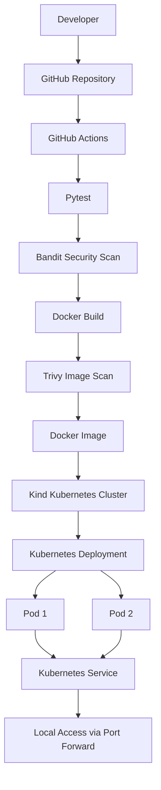

# DevOps Python API

A containerized REST API built with Python and Flask, featuring automated testing, security scanning, Docker image building, and Kubernetes deployment.

This project demonstrates a practical DevOps workflow, from application development and version control to continuous integration and container orchestration.

## Architecture



## Technology Stack

| Category                | Technology     |
| ----------------------- | -------------- |
| Programming language    | Python 3.12    |
| Web framework           | Flask          |
| Testing                 | Pytest         |
| Containerization        | Docker         |
| CI pipeline             | GitHub Actions |
| Code security           | Bandit         |
| Container security      | Trivy          |
| Container orchestration | Kubernetes     |
| Local Kubernetes        | Kind           |
| Version control         | Git and GitHub |

## Project Structure

```text
devops-python-api/
├── app/
│   ├── __init__.py
│   └── app.py
├── tests/
│   └── test_app.py
├── kubernetes/
│   ├── deployment.yml
│   └── service.yml
├── .github/
│   └── workflows/
│       └── ci.yml
├── .dockerignore
├── .gitignore
├── Dockerfile
├── requirements.txt
├── requirements-dev.txt
└── README.md
```

## Application Endpoints

| Method | Endpoint  | Description                       |
| ------ | --------- | --------------------------------- |
| GET    | `/`       | Returns an API welcome message    |
| GET    | `/health` | Returns application health status |

Example response from `/`:

```json
{
  "message": "DevOps API is running"
}
```

Example response from `/health`:

```json
{
  "status": "healthy"
}
```

## Getting Started

### Prerequisites

Install the following tools:

- Python 3.12
- Git
- Docker
- kubectl
- Kind

### 1. Clone the repository

```bash
git clone https://github.com/imann66/devops-python-api.git
cd devops-python-api
```

### 2. Create a virtual environment

Windows PowerShell:

```powershell
python -m venv .venv
.\.venv\Scripts\Activate.ps1
```

### 3. Install dependencies

```powershell
pip install -r requirements-dev.txt
```

### 4. Run the application

```powershell
python app/app.py
```

The API will be available at:

- http://localhost:5000/
- http://localhost:5000/health

### 5. Run automated tests

```powershell
python -m pytest -v
```

### 6. Run the Bandit security scan

```powershell
bandit -r app/
```

## Docker

### Build the Docker image

```powershell
docker build -t devops-python-api:latest .
```

### Run the container

```powershell
docker run --rm -p 5000:5000 devops-python-api:latest
```

Test the API:

```powershell
Invoke-RestMethod http://localhost:5000/health
```

### Scan the image with Trivy

```powershell
trivy image devops-python-api:latest
```

## Continuous Integration

The GitHub Actions workflow is located at:

`.github/workflows/ci.yml`

The pipeline performs the following tasks:

1. Checks out the source code.
2. Sets up Python 3.12.
3. Installs application and development dependencies.
4. Runs automated tests with Pytest.
5. Scans Python source code using Bandit.
6. Builds the Docker image.
7. Scans the Docker image using Trivy.

The Docker security job runs after the test and code security job succeeds.

The current Trivy configuration reports HIGH and CRITICAL findings without failing the pipeline (`exit-code: "0"`). This is an initial reporting configuration, not an enforcement gate.

## Kubernetes Deployment

This project uses Kind to run a local Kubernetes cluster.

### 1. Create the cluster

```powershell
kind create cluster --name devops-lab
```

Verify the cluster:

```powershell
kubectl get nodes
```

### 2. Build the Docker image

```powershell
docker build -t devops-python-api:latest .
```

### 3. Load the image into Kind

```powershell
kind load docker-image devops-python-api:latest --name devops-lab
```

The image is loaded directly into the local cluster, so a public image registry is not required for this workflow.

### 4. Deploy the application

```powershell
kubectl apply -f kubernetes/deployment.yml
```

Check the deployment:

```powershell
kubectl get deployments
kubectl get pods
```

Wait for the rollout:

```powershell
kubectl rollout status deployment/devops-python-api
```

### 5. Create the Kubernetes Service

```powershell
kubectl apply -f kubernetes/service.yml
```

Check the Service and its endpoints:

```powershell
kubectl get services
kubectl get endpoints devops-python-api-service
```

### 6. Access the application

Forward local port 8080 to the Service port 5000:

```powershell
kubectl port-forward service/devops-python-api-service 8080:5000
```

Keep this terminal running.

Open another terminal and test:

```powershell
Invoke-RestMethod http://localhost:8080/
Invoke-RestMethod http://localhost:8080/health
```

### 7. Monitor the deployment

```powershell
kubectl get pods -o wide
kubectl get deployments
kubectl describe deployment devops-python-api
kubectl get services
```

### 8. Update the deployment after changing code

Rebuild and reload the image:

```powershell
docker build -t devops-python-api:latest .
kind load docker-image devops-python-api:latest --name devops-lab
```

Restart the deployment:

```powershell
kubectl rollout restart deployment devops-python-api
kubectl rollout status deployment devops-python-api
```

### 9. Remove the local Kubernetes cluster

When finished:

```powershell
kind delete cluster --name devops-lab
```

This deletes the local cluster and its resources. It does not delete your GitHub repository.

## Key DevOps Concepts Demonstrated

- Version control and source code management using Git and GitHub.
- Automated testing and continuous integration with GitHub Actions.
- Python static security analysis using Bandit.
- Container image vulnerability scanning using Trivy.
- Docker image creation and container execution.
- Kubernetes Deployments and replica management.
- Kubernetes Services and application networking.
- Readiness and liveness probes.
- Deployment rollout and troubleshooting.

## Future Improvements

Potential next steps:

- Use Gunicorn instead of Flask's built-in development server.
- Publish Docker images to GitHub Container Registry.
- Enforce security scan thresholds in CI.
- Add automated deployment to Kubernetes.
- Add application logging and monitoring.
- Add resource requests and limits to Kubernetes workloads.
- Introduce Helm for Kubernetes configuration management.

## Author

**Iman**

GitHub: https://github.com/imann66
